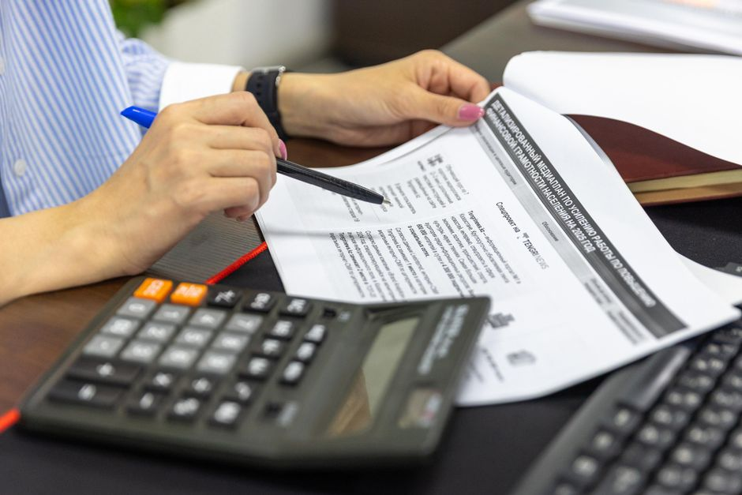

# Accounting

Ledger, bank reconciliation and financial reports.

## Daily work

### Bank reconciliation

Bank transactions sync daily and are matched to open invoices. Only unmatched lines need a review.

### Customer invoices

Invoices are created from [Sales](sales.md) orders and sent by email with an online payment link.

## Month-end

### Closing checklist

- Reconcile all bank accounts
- Review unpaid customer invoices
- Post depreciation entries
- Set the lock date

### Reports

| Report | Where |
| --- | --- |
| Profit & Loss | Accounting → Reporting |
| Balance Sheet | Accounting → Reporting |
| Aged Receivables | Accounting → Reporting → Partner reports |
